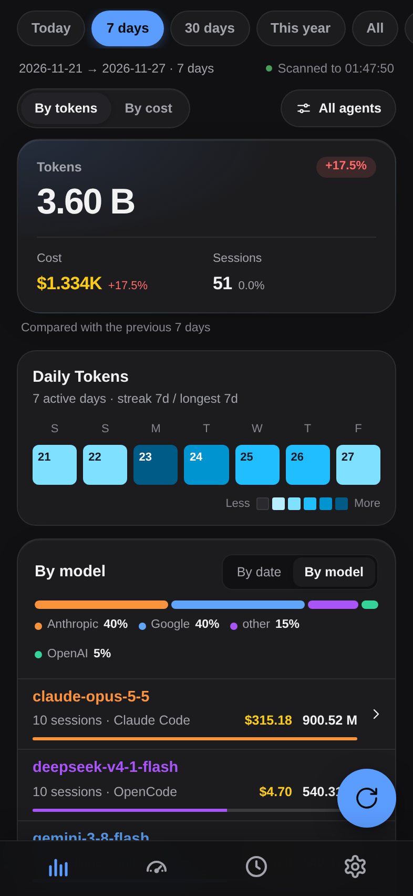
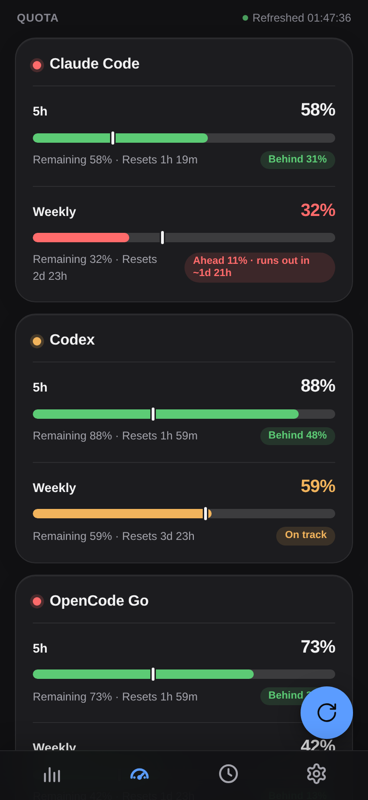

# TokenPulse

TokenPulse runs on the machine where your AI coding agents run and serves a
mobile-first web dashboard over Tailscale. It tracks token usage, cost, and
subscription quota in the background, with a terminal dashboard and plain-text,
JSON, and CSV outputs also built in.

<p>
  
  
</p>

*Screenshots use synthetic demo data rather than a real account.*

## Features

- **Mobile web dashboard** — `tokenpulse serve` keeps usage and quota fresh in
  the background and serves an installable PWA over Tailscale Serve HTTPS.
- **Usage & cost tracking** — unified Usage report across agents with range
  presets, period comparison, Token/Cost toggle, heatmaps, and per-day /
  per-model breakdowns backed by a local SQLite ledger.
- **Read-only quota tracking** — checks subscription rate-limit windows, reset
  times, pace, extra usage, and reset credits without ever writing or refreshing
  agent credentials.
- **Session Keeper** — optional scheduled heartbeats to trigger 5h cooldowns
  early and wake weekly windows after resets (off by default).
- **Terminal & scripting outputs** — interactive TUI (`tokenpulse`), plain text
  (`--no-tui`), `--json`, and `--csv daily|models`.

## Supported Agents

| Agent | Usage | Quota |
|---|---|---|
| Claude Code | ✅ | ✅ |
| Codex | ✅ | ✅ |
| OpenCode / OpenCode Go | ✅ | ✅ |
| Antigravity | ✅ | ✅ |
| GitHub Copilot | ✅ | — |
| Gemini CLI | ✅ | — |
| PI | ✅ | — |

Quota fetching is off by default — enable it in Settings or via
`tokenpulse config set refresh_quota=true`. OpenCode Go stays hidden when the
account has no Go subscription.

## Install

Install TokenPulse on the machine where your AI coding agents run. Prebuilt
binaries are published for macOS (Intel / Apple Silicon) and Linux (x64 /
arm64).

```bash
# Global install (bun or npm)
bun add -g @fangwangme/tokenpulse
npm install -g @fangwangme/tokenpulse

# Or run directly without installing
bunx @fangwangme/tokenpulse serve
npx @fangwangme/tokenpulse serve
```

See [Build from Source](docs/USAGE.md#build-from-source) if you prefer compiling
with Go and Node.

## Quick Start

Start the web dashboard:

```bash
tokenpulse serve
```

Scan the printed QR code or open the pairing URL on a phone on the same
tailnet, then add it to your home screen.

Other common commands:

```bash
# Run as a background service (systemd on Linux, launchd on macOS)
tokenpulse service install

# Open the terminal dashboard
tokenpulse
```

## Documentation

- **[Usage & Configuration Guide](docs/USAGE.md)** — CLI flags & exports, TUI
  keybindings, `config set` options, Session Keeper, Tailscale/LAN options,
  local storage, and building from source.
- **[Specs](docs/specs)** & **[Design Notes](docs/DESIGN.md)** — architecture
  and binding behavior.

## Acknowledgments

TokenPulse was inspired by and builds on ideas from:

- **[CodexBar](https://github.com/steipete/CodexBar)** by [@steipete](https://github.com/steipete) —
  auth flows and quota API patterns.
- **[tokscale](https://github.com/junhoyeo/tokscale)** by [@junhoyeo](https://github.com/junhoyeo) —
  multi-tab dashboard layout and multi-agent attribution.
- **[openusage](https://github.com/robinebers/openusage)** by [@robinebers](https://github.com/robinebers) —
  provider coverage and extensible quota sources.
