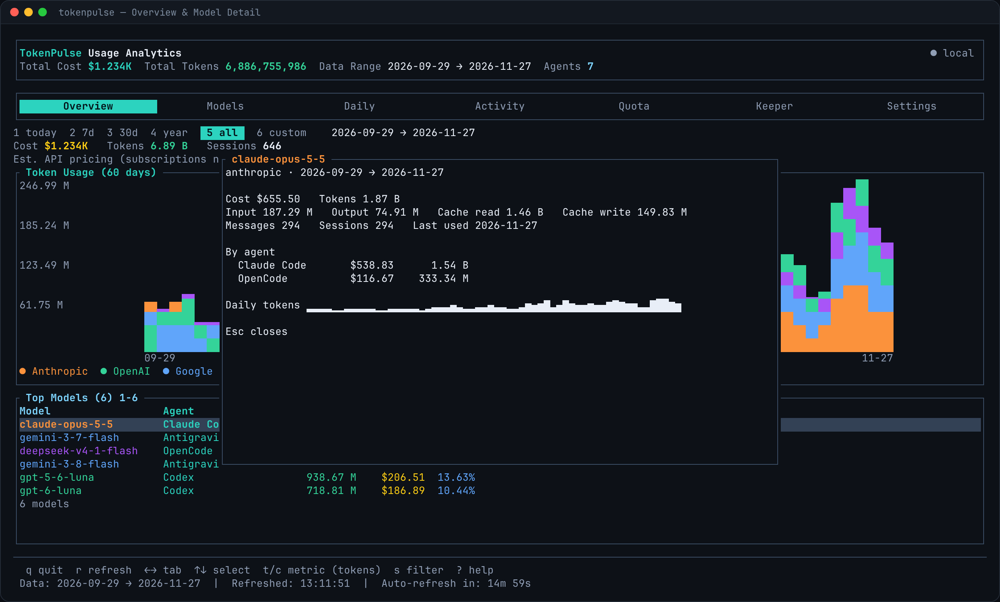
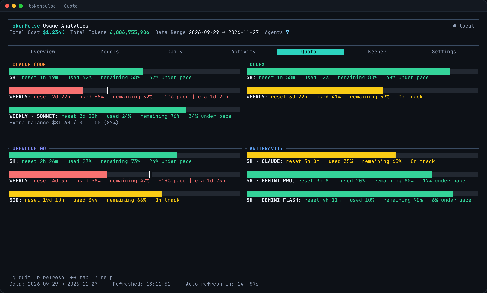

# Usage & Configuration Guide

Detailed reference for TokenPulse's mobile web dashboard, terminal dashboard
(TUI), CLI, configuration, local storage, and building from source.

TokenPulse exposes the same live usage report, quota snapshots, Session Keeper,
and settings through two interactive surfaces — the **Mobile Web Dashboard** and
the **Terminal Dashboard (TUI)** — plus scriptable CLI outputs.

## Mobile Web Dashboard

### Starting & Pairing

Start the background server on the computer that holds your agent sessions:

```bash
tokenpulse serve
```

`serve` prints a pairing URL and QR code. The token lives in the URL fragment so
it never reaches a request line or server log. Open the URL on a phone on the
same tailnet; you can add the web app to your home screen as an installable PWA.

Default ports are `4120` (local HTTP) and `8444` (Tailscale Serve HTTPS); test
runs (`TOKENPULSE_ENV=test`) use `14120` and `18444`.

- `--no-tailscale` binds localhost only.
- `--lan` binds all interfaces and warns that LAN traffic is not encrypted.
- `tokenpulse remote url` prints the pairing URL and QR code again.
- `tokenpulse remote reset-token` invalidates all paired phone sessions.
- `tokenpulse service install` installs a systemd user unit on Linux (or a
  launchd agent on macOS) that runs `serve` and restarts it on failure.
- One runtime owns refreshing behind `runtime.lock`. You can also toggle
  **Web remote** from the TUI Settings tab to start or stop a background `serve`
  without leaving the dashboard.

### Mobile Pages

The bottom tab bar switches between four mobile-first views:

- **Usage** — opens on `today` with range presets (`today`, `7d`, `30d`, `year`,
  `all`, `custom`), KPI cards (cost, tokens, sessions, period comparison),
  Token/Cost switch, agent filter, adaptive heatmap (strip / week rows / week
  columns with streaks), and a `By date | By model` list that opens day and
  model detail sheets.
- **Quota** — per-provider cards in `display.quota_provider_order` with plan and
  account info, rate-limit bars, pace, reset times, extra usage, and banked
  reset credits.
- **Keeper** — master switch, per-agent 5h/weekly toggles, wakeup time editing,
  Antigravity group option, manual test pings, and recent executions.
- **Settings** — refresh interval, quota display mode, drag-to-reorder and
  enable/disable quota providers, theme (light/dark/system), language, and Web
  Push alerts for quota recovery (on iOS, add the app to the Home Screen first).

Full remote/PWA behavior is specified in [`specs/remote.md`](specs/remote.md).

## Terminal Dashboard (TUI)

Launch the interactive desktop dashboard in any terminal:

```bash
tokenpulse
```

If `tokenpulse serve` is already running, the TUI attaches over the local Unix
socket (`● web`) and stays in sync with the phone; otherwise it runs an
in-process runtime (`● local`). Pass `--since YYYY-MM-DD` to open on a custom
range from that date to today, or `--no-scan` to read only the cached ledger.

<p>
  
</p>
<p>
  
</p>

### Tabs

The TUI has seven tabs (switch with `←`/`→`, `h`/`l`, `Tab`/`Shift+Tab`, or by
clicking a tab):

- **Overview** — KPI row (cost, tokens, sessions, comparison deltas, estimate
  and unpriced notices), stacked daily bar chart split by company (`Anthropic`,
  `OpenAI`, `Google`, `Others`), and Top Models table (`Enter` opens model
  detail).
- **Models** — full sortable model breakdown (`Tokens`, `Cost`, `Input`,
  `Output`, `Cache R`, `Cache W`, `Hit %`, `%`, `Msgs`, `Last`); `Enter` opens
  model detail.
- **Daily** — per-date breakdown with `Token vs 7d` / `Cost vs 7d` comparison
  against 7 days earlier; `Enter` opens day detail (per-agent and per-model
  cost, tokens, `CR`, `CW`, and `Hit %`).
- **Activity** — fixed one-year Monday-start heatmap with streaks, period
  overview (`Today`, `Week`, `Month`, `Year`, `Last 7 days`, `Last 30 days`),
  and selected-day breakdown. Ignores the shared range.
- **Quota** — multi-column provider cards in `display.quota_provider_order` with
  gauges, pace, reset times, extra usage, and banked reset credits.
- **Keeper** — engine master switch, per-agent cards (5h wakeup, weekly sync,
  last run, manual ping), and live execution stream (newest first).
- **Settings** — live config editor (display options, theme, notifications,
  Keeper, **Web remote** start/stop, and quota provider toggles + reordering).

Overview, Models, and Daily share one range bar (default `30d`) and the global
agent filter (`s`).

### TUI Keybindings

| Scope | Key | Action |
| :--- | :--- | :--- |
| Global | `←` / `→`, `h` / `l`, `Tab` / `Shift+Tab` | Switch tabs (`Tab`/`Shift+Tab` select agent cards on Keeper; mouse click on tabs also works) |
| Global | `↑` / `↓`, `j` / `k` | Navigate lists / scroll open detail popups |
| Global | `s` | Open agent filter overlay (`Space`/`Enter` toggle, `a` select all) |
| Global | `b` | Toggle light / dark theme |
| Global | `r` | Refresh usage and quota |
| Global | `?` | Toggle per-page keybinding help overlay |
| Global | `Esc` | Close detail popup, custom range input, filter, or help (never quits) |
| Global | `q` / `Ctrl+C` | Quit |
| Overview, Models, Daily | `1`–`6` | Select range preset (`today`, `7d`, `30d`, `year`, `all`, `custom`) |
| Overview, Models, Daily | `[` / `]` | Shift range one window earlier / later |
| Overview, Models, Daily | `n` | Return to preset ending today (on Daily, also select today's row) |
| Overview | `t` / `c`, `Enter` | Switch chart & top models to tokens / cost; open selected model detail |
| Models | `c` / `t` / `d`, `Enter` | Sort by cost / tokens / last used (repeat to reverse); open model detail |
| Daily | `c` / `t` / `d`, `v`, `Enter` | Sort by cost / tokens / date; toggle vs-7d metric; open day detail |
| Activity | `↑` / `↓` (`j`/`k`), `n`, `t` / `c`, `[` / `]` | Move selected day; jump to today; tokens/cost heatmap; scroll day detail |
| Keeper | `↑` / `↓` / `Tab`, `1` / `d`, `2` / `w`, `p`, `e` | Select agent card; toggle 5h / weekly keeper; manual ping; toggle engine |
| Settings | `↑` / `↓` (`j`/`k`), `Space` / `Enter`, `J` / `K` | Move selection; cycle/toggle setting; reorder quota provider down / up |

Full TUI behavior is specified in [`specs/tui-usage.md`](specs/tui-usage.md).

## CLI & Exports

```bash
# Detect installed providers and write initial config
tokenpulse init --default

# Interactive terminal dashboard (auto-detects TTY)
tokenpulse

# Plain-text summary (scripting / remote shells)
tokenpulse --no-tui

# JSON payload (usage + quota)
tokenpulse --json

# CSV exports
tokenpulse --csv daily
tokenpulse --csv models
```

### Filters & Maintenance

```bash
# Read the cached ledger without scanning
tokenpulse --no-scan

# Show data starting from a specific date
tokenpulse --since 2026-04-01

# Re-parse a specific date range
tokenpulse --refresh-days 2026-04-01:2026-04-09

# Force a fresh pricing fetch (otherwise uses cached pricing)
tokenpulse --refresh-pricing

# Preview or apply repricing under current price rules
tokenpulse reprice

# Full rebuild from scratch
tokenpulse --rebuild-all

# Write timing diagnostics to a log file
tokenpulse --log
```

> [!IMPORTANT]
> **Antigravity sync after rebuild**: After running `--rebuild-all`, launch the
> Antigravity CLI and Desktop together once so both can sync and align history.

## Configuration

```bash
# Show current config
tokenpulse config show

# Enable / disable quota providers (claude, codex, opencode, antigravity)
tokenpulse config enable claude
tokenpulse config disable antigravity

# Quota provider order (also editable by dragging in the web app's Settings)
tokenpulse config set quota_provider_order=opencode,claude,codex,antigravity

# Quota display mode: "remaining" (default) or "used"
tokenpulse config set quota_display_mode=used

# Theme: auto, dark, light
# "auto" follows the OS appearance and re-checks on each refresh (macOS).
tokenpulse config set theme=dark

# Auto-refresh interval in minutes for quota + usage (0, 1, 2, 5, 10, 15; 0 = disabled)
tokenpulse config set auto_refresh_interval=15

# Show empty providers in the dashboard
tokenpulse config set show_empty_providers=true

# Account row in quota cards: none, plan, or full (plan + email; default)
tokenpulse config set account_display=plan

# Enable / disable quota refresh (default: false)
tokenpulse config set refresh_quota=true

# Quota recovery alerts:
#   off       nothing at all
#   in_app    sound + in-TUI toast and ambient pulse
#   terminal  ... plus a terminal bell and an OSC 9 desktop notification
#   system    ... plus a macOS Notification Center banner
tokenpulse config set notification_level=system

# Alert sound for every level except "off": "chime" (built-in), "none",
# or any sound name under /System/Library/Sounds.
tokenpulse config set notification_sound=chime

# Send a sample alert to verify sound and notifications
tokenpulse config test-notification
```

> **Note on audibility**: Sounds play through `afplay` rather than the terminal
> bell because most terminals disable the audible bell by default (for example,
> Ghostty defaults to `bell-features = no-system,no-audio`). The built-in chime
> is normalized roughly 11 dB above macOS `Ping.aiff`. If
> `notification_level=system` shows no banner, allow your terminal to post
> notifications in System Settings > Notifications.

If `config.toml` has a syntax error, commands and Settings rows leave it
untouched and report the error rather than overwriting it from defaults.

## Session Keeper

The **Keeper** tab manages optional scheduled pings for Claude Code, Codex, and
Antigravity to start 5h cooldown cycles early and wake weekly windows after a
reset.

Because every ping spends real quota, the engine ships **disabled**. Enable it
in the Keeper or Settings tab, then opt in per agent. Wakeup times, prompts, and
command templates live under `[keeper]` in `config.toml`; Keeper picks the
cheapest active model per agent from local catalogs at startup and once a day.
The Keeper tab shows the newest 20 runs; full history stays in `tokenpulse.db`.

## Data Sources & Model

### Session & Credential Sources

| Agent | Usage Source | Quota Support |
|---|---|---|
| Claude Code | `~/.claude/projects/` / `~/.claude/transcripts/` | ✅ |
| Codex | `~/.codex/sessions/` | ✅ |
| OpenCode | `${XDG_DATA_HOME:-~/.local/share}/opencode/` (1.x/2.x or `OPENCODE_DB`) | ✅ (OpenCode Go) |
| Antigravity | Language Server (GUI/CLI), local conversation databases | ✅ |
| GitHub Copilot | `~/.local/share/github-copilot/events.jsonl` | — |
| Gemini CLI | `~/.gemini/tmp/` | — |
| PI | `~/.pi/agent/sessions/` | — |

- Gemini usage handles streamed JSONL deduplication and cache-inclusive input
  tokens.
- Antigravity usage syncs with running Language Servers (GUI/CLI) and keeps a
  raw cache under `~/.local/share/tokenpulse/antigravity-cache/`.
- OpenCode Go reads the active credential from OpenCode's local SQLite database
  read-only and stays hidden when the account has no Go subscription.

### Agent vs. Provider

TokenPulse keeps two concepts separate so the same model family can be
attributed across multiple tools:

- **Agent** — the coding tool you used (`Claude Code`, `Codex`,
  `GitHub Copilot`, `OpenCode`, `Gemini CLI`, `PI`, `Antigravity`).
- **Provider** — the model vendor (`Anthropic`, `OpenAI`, `Google`,
  `GitHub Copilot`).

## Local Storage

All local state lives under `~/.local/share/tokenpulse/` (mode `0700`):

```text
~/.local/share/tokenpulse/
├── config.toml        # user configuration
├── keeper_state.json  # Keeper last-fired bookkeeping
├── usage.db           # SQLite usage ledger + price periods
├── tokenpulse.db      # quota cache + quota/Keeper observation history
├── pricing-cache.json # cached model pricing catalog
├── antigravity-cache/ # raw Antigravity session cache and learned aliases
├── remote.json        # remote token and hashed phone sessions
├── serve.sock         # local control socket while serve runs
├── vapid.json         # Web Push key pair
└── log/               # rotating diagnostics log
```

Set `TOKENPULSE_DATA_DIR` to move this directory, or `TOKENPULSE_CONFIG_PATH` to
override only `config.toml`. `TOKENPULSE_ENV=test` marks a test run and requires
`TOKENPULSE_DATA_DIR`.

`tokenpulse.db` keeps an append-only history of every quota poll and Keeper run
with no automatic retention limit — delete old rows yourself if it grows too
large.

## Build from Source

Requires Go 1.27+ and Node 20+ (to build the embedded web app):

```bash
git clone https://github.com/fangwangme/tokenpulse
cd tokenpulse/web && npm ci && npm run build && cd ..
go build -o tokenpulse .
```

If you only need the CLI/TUI (without the web app), `go install` works without
Node and embeds a placeholder page at `/`:

```bash
go install github.com/fangwangme/tokenpulse@latest
```

### Development & Project Layout

```bash
gofmt -w .
go vet ./...
go test ./...

# Web app (embedded into the Go binary from web/dist)
cd web && npm ci && npm run build
```

```text
tokenpulse/
├── main.go                  # CLI entrypoint
├── internal/
│   ├── cli/                 # commands and output
│   ├── config/              # config.toml model and persistence
│   ├── keeper/              # scheduled agent pings
│   ├── pricing/             # catalog, price periods, reprice
│   ├── quota/               # read-only quota fetchers and cache
│   ├── remote/              # serve, auth, API, Tailscale, push, local client
│   ├── report/              # shared usage report queries
│   ├── scan/                # refresh orchestration
│   ├── service/             # systemd/launchd install
│   ├── tui/                 # Bubble Tea dashboard
│   └── usage/               # session parsers and SQLite store
├── web/                     # Solid + TypeScript + Vite phone app
├── testdata/parity/         # synthetic parser and quota fixtures + goldens
└── docs/
    ├── USAGE.md             # this guide
    ├── specs/               # binding behavior
    └── DESIGN.md            # design notes
```
